# auto-pack

作业型自动打包控制台（2.0）。配置（空间 / 工程 / 环境）与执行（作业）分开；UI 用 [ensis-ui](https://github.com/Blair-Shang/ensis-ui)；平台库支持 SQLite / PostgreSQL / MySQL。

试用版 1.0.0 已冻结：tag `v1.0.0`，源码在 [legacy/](legacy/)。

## 版本

| 名称 | 示例 | 管什么 |
|------|------|--------|
| 控制台 SemVer | `v2.0.0` | 本仓库；见 [CHANGELOG.md](CHANGELOG.md) |
| 产品发版 Tag | `V9.0.0-P01` | 被打包工程，只出现在作业参数里 |

发版只改根目录 `package.json` 的 `version` 和 [CHANGELOG.md](CHANGELOG.md)。说明可写在 `## [Unreleased]`，**建议在同一提交里收成** `## [x.y.z] - YYYY-MM-DD`。推到 `master` 后，若该版本尚未有 `v*` tag / Release 且 changelog 有说明，Actions 会按**该提交 SHA** 打包、打 tag 并发 GitHub Release；**不再回写 master 或改 CHANGELOG**（避免与本地继续开发抢分支）。`pnpm dev` / 打包会跑 `node script/sync-version.mjs`，把号写入 `server/internal/config.AppVersion`；发行包还会用 `-ldflags` 再注入一次。

## 目录

```
server/                 # Go 控制面
  cmd/                  # 入口
  configs/app.yaml.example  # 复制为 app.yaml；本机 yaml 不入库
  internal/
    config/             # YAML + AppVersion
    store/              # 三库连接与事务
    migrate/            # init.sql + 98_patch.sql
    iam/                # 身份 / 空间成员 / 动作
    crypt/              # 环境密文
    token/              # JWT，无 HTTP
    web/                # L4 HTTP，按功能模块划分
      mod/ router/      # 前缀与组装；router 不写业务路径
      health/ auth/ jobs/ workspaces/ projects/ envs/ users/ audit/
    host/               # 本机工具族（bash git npm maven ftp）
    job/                # 作业控制面（入队 / 查询 / 取消 / cron）
      runner/           # 执行面
    workspace/ project/ env/ user/ audit/
src/                    # Vue 3 + ensis-ui
script/
  db/                   # sqlite / mysql / postgres DDL
  build/                # Windows / Linux 全局构建
  run/                  # 启停模板（打进发行包根目录）
  package/              # 发行包说明
legacy/                 # v1.0.0 试用版
```

## 启动

```bash
# 需 Node >= 20、pnpm、Go；UI 从 npm 装 ensis-ui
# 首次：复制示例配置，再按本机改 DSN / 密钥（app.yaml 不进 git）
#   Copy-Item server/configs/app.yaml.example server/configs/app.yaml
pnpm install
pnpm dev          # Vite :5173 + 后端 :8080
# pnpm dev:web    # 只前端
# pnpm dev:server # 只后端
```

浏览器：http://localhost:5173/autopack/  
API：`/autopack/api/...`  
默认账号：`admin` / `123456`

`app.yaml` 里 `database.driver` 可改为 `postgres` 或 `mysql`。`workspace.root` 是所有空间与工程的检出根目录，默认 `./data/workspaces/{空间编码}/{工程名}`。

## 发行包

全局构建把前端、后端和运维脚本打进 `build/dist/auto-pack-{版本}-{os}-{arch}/`，按 `bin` / `web` / `configs` / `script/db` 分开，不带源码和本机密钥。说明见 [script/README.md](script/README.md)。

```powershell
pnpm package:windows
# 或交叉编 Linux：
# powershell -NoProfile -ExecutionPolicy Bypass -File script/build/windows.ps1 -OS linux
```

```bash
pnpm package:linux
# 或：bash script/build/linux.sh --os windows
```

到发行目录后：`start.bat` / `./start.sh`。浏览器 http://127.0.0.1:8080/autopack/

已用发行包启动的实例可在 **设置 → 界面升级** 上传同平台的 `auto-pack-{版本}-{os}-{arch}.tar.gz`（Windows 亦可 `.zip`）与 SHA256，由控制台替换 `bin` / `web` / `script` 后重启；`configs/*.yaml`、`data`、`logs` 保留。开发态 `go run` / `pnpm dev` 不可升级。

GitHub Actions（[`.github/workflows/pack.yml`](.github/workflows/pack.yml)）在发版时打包，不跟每次无关提交：

| 触发 | 行为 |
|------|------|
| 推 `master` | `package.json` 版本未打过 `v*` tag，且 CHANGELOG 的 Unreleased 或同号章节有说明 → 按该提交打 Linux / Windows amd64 包、打 tag、发 Release（不回写仓库） |
| 推 `v*` 标签 | 须与 `package.json` 一致；已有 Release 资产则跳过，否则打包并发 Release |
| Actions 手动 Run | 只打 Artifact，不发版 |

私人仓库只留最近一次构建 Artifact。

## 权限（2.0）

JWT 只证明身份。写操作走 `iam.Allow(actor, workspace, action)`。

| 角色 | 动作 |
|------|------|
| owner | 全部 |
| operator | `job.submit` `job.cancel` `project.write` `env.write` `audit.read` |
| viewer | 只读作业与日志 |

`user.admin` 管成员与动作矩阵。完整 RBAC UI 在用户页；闸在 service，不在 Runner。

## 外部打包

其它平台（如 BOMS）把打包通知写入**阿里云 MNS** 队列。在全局环境里新增并启用一条 `mq` 后才会订阅，不写在 `app.yaml`，也不读进程环境变量。OSS / FTP / SMTP 同样用平台环境。仓库地址不随报文下发，按 `customerBranch` 与工程 `repo_branch` 关联工作空间后构建。

实现见 `server/internal/intake/`、`server/internal/host/mns/`。

```mermaid
flowchart TD
  MQ["通知队列"] --> Parse["解析报文"]
  Parse -->|无法解析或 taskId 为空| ReceiptFail["失败回执"]
  Parse --> Claim{"taskId 是否已有记录"}
  Claim -->|已有| Replay["不重复打包<br/>按已有结果再写回执"]
  Claim -->|新任务| Check{"报文校验"}
  Check -->|不通过| ReceiptFail
  Check -->|通过| Job["按 customerBranch=repo_branch<br/>关联工作空间并提交构建"]
  Job --> Run["同步并构建<br/>成功邮件先挂起"]
  Run -->|构建失败| FailMail["作业结束邮件：失败"]
  FailMail --> ReceiptBuild["失败回执，不上传"]
  Run -->|构建成功| Upload{"按报文路径上传"}
  Upload -->|ossProjectRoot| OSS["平台 OSS 环境<br/>上传并签发临时链接"]
  Upload -->|ftpProjectRoot| FTP["平台 FTP / SFTP 环境"]
  OSS --> UpOK{"上传是否成功"}
  FTP --> UpOK
  UpOK -->|失败| UpMail["结果邮件：失败<br/>作业状态仍为成功"]
  UpMail --> ReceiptUp["失败回执"]
  UpOK -->|成功| OkMail["结果邮件：成功<br/>OSS 附带临时访问地址"]
  OkMail --> ReceiptOK["成功回执，消息键 taskId"]
  ReceiptFail --> MQOut["回执队列"]
  Replay --> MQOut
  ReceiptBuild --> MQOut
  ReceiptUp --> MQOut
  ReceiptOK --> MQOut
```



同一 `taskId` 无论进行中、成功或失败，再次投递都不重新打包。已有结果原样再写一笔回执；还在处理时回执说明不重复打包。回执写入失败会重试，耗尽后把该任务记为回执失败，不改成成功。邮件失败不影响回执。

### mq 环境（阿里云 MNS）

不配打包工程。`customerBranch` 与工程 `repo_branch` 匹配后关联到唯一工作空间，然后做该工作空间的自动构建，结束后从与工作空间编码同名的最终工程推送。该工程若配置了本机源码目录（例如空间编码 `V9.0.0-P08`，工程名也是 `V9.0.0-P08`，目录 `/home/appinstall/V9.0.0-P08`），包从该目录读取；其它工程构建后把 war 汇总到这里。未配置本机目录时，仍从该工程在工作空间下的检出目录读取。空间侧用「批量改 Git 分支」把 `repo_branch` 设成与 BOMS 报文一致即可。OSS 项目传 `ossProjectRoot`，FTP 项目传 `ftpProjectRoot`。

| 字段 | 作用 |
|------|------|
| `endpoint` | MNS Endpoint，如 `https://{AccountId}.mns.cn-hangzhou.aliyuncs.com` |
| `request_queue` | 请求队列（本服务消费），测试环境样例 `BOMS-DEVTSK-PACK-REQ-TEST` |
| `result_queue` | 结果队列（本服务生产回执），测试环境样例 `BOMS-DEVTSK-PACK-RESULT-TEST` |
| `access_key_id` / `access_key_secret` | 无 STS；签名不含 security-token |
| `batch_size` | 每次拉取条数，默认 10 |
| `receipt_retries` | 回执重试次数，默认 3 |

接入要点：

- 签名串：`METHOD` / `Content-MD5` / `Content-Type` / `Date` / `x-mns-version:2015-06-06` / `resourcePath`（`\n` 分隔；空字段占行；`resourcePath` 以 `/queues/` 开头含 query，末尾无换行）。HMAC-SHA1 + Base64 → `Authorization: MNS {AK}:{Sig}`。
- 收：`GET /queues/{名}/messages?numofmessages=N&waitseconds=0`；`404 MessageNotExist` 表示空队列，属正常。
- 删：业务 `Handle` 成功后再 `DELETE ...?ReceiptHandle=`（句柄按 Java `URLEncoder` 规则编码）。
- 发：`POST` XML，`<MessageBody>` 为 JSON 的 UTF-8 再标准 Base64；`Content-MD5` 针对整段 XML。

### 通知报文（消费）

MNS `MessageBody` 解 Base64 后为下列 JSON（样例对齐 BOMS → DataHub）：

```json
{
  "taskId": "TSKIDS-20260703172557000175",
  "taskNo": "20260703172557000175",
  "packTaskId": "PACKTSKID-S01-20260703172557000175",
  "customerCode": "LSYM",
  "customerShortName": "零食有鸣",
  "resourceFiles": "app.war,config.zip",
  "mailTo": "zhangsan,lisi",
  "version": "V9.0.0",
  "subsystemType": "DATAHUB",
  "packagingMode": "war",
  "deploymentStrategy": "war",
  "ossProjectRoot": "/开发/S01/",
  "customerBranch": "release/V9.0.0_LSYM",
  "baseRef": "V9.0.0_P11",
  "baseRefType": "tag",
  "SYSVAL": "V10DATAHUB"
}
```

FTP 项目把 `ossProjectRoot` 换成 `ftpProjectRoot`，例如 `"/ftp/S01/"`。有 `ossProjectRoot` 只推 OSS；只有 `ftpProjectRoot` 才推 FTP。两条都写出时只走 OSS。

| 字段 | 说明 |
|------|------|
| `taskId` | 必填。同一笔打包的处理键和回执键，再次到达不重复打包。 |
| `taskNo` | 必填。业务任务号，写入回执和推送通知邮件。 |
| `packTaskId` | 必填。外部打包任务标识，原样写入回执。 |
| `resourceFiles` | 可选。要推送的资源文件，多个用英文逗号分隔，如 `app.war,config.zip`。按文件名在最终工程目录中查找。写出后只推这些文件；不写则推送全部 `war`。 |
| `mailTo` | 可选。收件人账号，多个用英文逗号分隔，如 `zhangsan,lisi`。处理时没有 `@` 的自动补成 `@flux.com.cn`；已经写完整邮箱的保持原样。未填时用所关联 SMTP 环境里的收件人。 |
| `customerCode` | 必填。客户代码，原样进入打包参数，并写入推送通知。 |
| `customerShortName` | 项目名称。写入推送通知的「项目名称」，样例「零食有鸣」。 |
| `version` | 必填。产品版本，原样进入打包参数。 |
| `subsystemType` | 必填。必须为 `DATAHUB`。 |
| `packagingMode` | 必填。必须为 `war`。 |
| `deploymentStrategy` | 必填。必须为 `war`。 |
| `ossProjectRoot` | OSS 项目的对象目录，与 `ftpProjectRoot` 至少填一个。上传走消息队列关联的 OSS，未关联时用已启用的 OSS，并签发临时访问地址。 |
| `ftpProjectRoot` | FTP 项目的目录，与 `ossProjectRoot` 至少填一个。样例 `"/ftp/S01/"`。上传走消息队列关联的 FTP / SFTP / SSH。 |
| `customerBranch` | 必填。与平台工程 `repo_branch` 相等，用来关联工作空间，并作为构建检出分支。 |
| `baseRef` | 必填。基线引用，本期与 `baseRefType` 一起校验。 |
| `baseRefType` | 必填。本期必须为 `tag`。 |
| `SYSVAL` | 可选。原样进入打包参数，样例 `V10DATAHUB`。 |
| `sourceMetadata` | 禁止出现。出现则视为旧报文，校验失败并回执。 |

仓库 URL 不读报文。缺必填字段或不在允许范围时：不打包、不上传，直接写失败回执。`taskTitle`、`passedAt`、`publishedAt` 可以出现，本服务不使用。

关联了 SMTP 和邮件模板后，打包和推送都成功才发信。报文有 `ossProjectRoot` 用「OSS 已更新」，只有 `ftpProjectRoot` 用「FTP 已更新」。发件人是 DATAHUB 更新通知 \<fluxdatahub@flux.com.cn\>，更新范围固定为 DATAHUB服务。两套模板版式相同。OSS 覆盖前若对象已存在，先复制到同目录 `BAK/{时间戳}/`，邮件「备份」栏写该路径。不附构建日志。构建日志留在平台，末尾追加与回执相同的三步。回执按 1 打包、2 推送、3 邮件 写结果，每步带耗时，并另给 `metadata` 数组。

### 回执报文（生产）

写入 `result_queue`（MNS 发送）。`resultMessage` 最长 500 字；`finishedAt` 与各步时间为 `yyyy-MM-dd HH:mm:ss`（东八区）。`metadata` 与三步正文一致，时间放在数组里，不受 `resultMessage` 截断影响。

成功：

```json
{
  "taskId": "TSKIDS-20260703172557000175",
  "taskNo": "20260703172557000175",
  "packTaskId": "PACKTSKID-S01-20260703172557000175",
  "subsystemType": "DATAHUB",
  "packagingMode": "war",
  "deploymentStrategy": "war",
  "ossProjectRoot": "/开发/S01/",
  "resultStatus": "SUCCESS",
  "resultMessage": "1. 打包：成功。自动打包完成，war 已推送到项目路径，耗时 43秒\n2. 推送：成功，OSS 路径 /开发/S01/app.war，资源 app.war,config.zip，耗时 2秒\n3. 邮件：已发送 收件人 a@example.com,b@example.com，模板 OSS 已更新，耗时 1秒",
  "finishedAt": "2026-07-03 18:06:21",
  "metadata": [
    {"step": 1, "name": "打包", "status": "成功", "message": "自动打包完成，war 已推送到项目路径", "startedAt": "2026-07-03 18:05:37", "finishedAt": "2026-07-03 18:06:20", "elapsed": "43秒"},
    {"step": 2, "name": "推送", "status": "成功", "message": "OSS 路径 /开发/S01/app.war，资源 app.war,config.zip", "startedAt": "2026-07-03 18:06:20", "finishedAt": "2026-07-03 18:06:22", "elapsed": "2秒"},
    {"step": 3, "name": "邮件", "status": "已发送", "message": "收件人 a@example.com,b@example.com，模板 OSS 已更新", "startedAt": "2026-07-03 18:06:22", "finishedAt": "2026-07-03 18:06:23", "elapsed": "1秒"}
  ]
}
```

失败时 `resultStatus` 为 `FAILED`，`resultMessage` 说明原因（校验 / 构建 / 上传）。`ossProjectRoot` 回填通知里的目标路径。

| 阶段 | 上传 | 回执 | 邮件 |
|------|------|------|------|
| 报文校验失败 | 不上传 | `FAILED` | 发送（有收件人时） |
| war 构建失败 | 不上传 | `FAILED` | 作业结束邮件 |
| 构建成功、上传失败 | 未完成 | `FAILED` | 结果邮件 |
| 上传成功 | 已落在目标路径 | `SUCCESS` | 结果邮件（OSS 带临时链接） |

## 作业类型

`build` · `release` · `ftp_push` · `pom_version` · `branch_clone` · `sync_sources`

cron 只负责入队，不直接跑构建。
