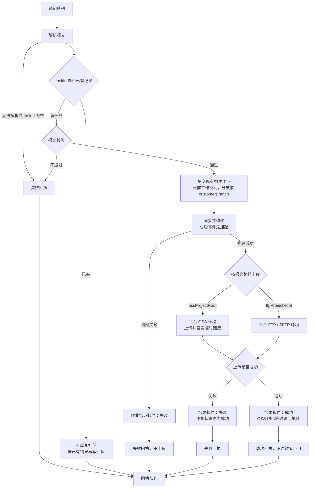

# auto-pack

作业型自动打包控制台（2.0）。配置（空间 / 工程 / 环境）与执行（作业）分开；UI 用 [ensis-ui](https://github.com/Blair-Shang/ensis-ui)；平台库支持 SQLite / PostgreSQL / MySQL。

试用版 1.0.0 已冻结：tag `v1.0.0`，源码在 [legacy/](legacy/)。

## 版本

| 名称 | 示例 | 管什么 |
|------|------|--------|
| 控制台 SemVer | `v2.0.0` | 本仓库；见 [CHANGELOG.md](CHANGELOG.md) |
| 产品发版 Tag | `V9.0.0-P01` | 被打包工程，只出现在作业参数里 |

发版只改根目录 `package.json` 的 `version` 和 [CHANGELOG.md](CHANGELOG.md)。`pnpm dev` / 打包会跑 `node script/sync-version.mjs`，把号写入 `server/internal/config.AppVersion`；发行包还会用 `-ldflags` 再注入一次。

## 目录

```
server/                 # Go 控制面
  cmd/                  # 入口
  configs/app.yaml.example  # 复制为 app.yaml；本机 yaml 不入库
  internal/
    config/             # YAML + AppVersion
    store/              # 三库连接与事务
    migrate/            # init.sql + 98_patch.sql
    iam/                # 身份 / 空间成员 / 动作
    crypt/              # 环境密文
    token/              # JWT，无 HTTP
    web/                # L4 HTTP，按功能模块划分
      mod/ router/      # 前缀与组装；router 不写业务路径
      health/ auth/ jobs/ workspaces/ projects/ envs/ users/ audit/
    host/               # 本机工具族（bash git npm maven ftp）
    job/                # 作业控制面（入队 / 查询 / 取消 / cron）
      runner/           # 执行面
    workspace/ project/ env/ user/ audit/
src/                    # Vue 3 + ensis-ui
script/
  db/                   # sqlite / mysql / postgres DDL
  build/                # Windows / Linux 全局构建
  run/                  # 启停模板（打进发行包根目录）
  package/              # 发行包说明
legacy/                 # v1.0.0 试用版
```

## 启动

```bash
# 需 Node >= 20、pnpm、Go；UI 从 npm 装 ensis-ui
# 首次：复制示例配置，再按本机改 DSN / 密钥（app.yaml 不进 git）
#   Copy-Item server/configs/app.yaml.example server/configs/app.yaml
pnpm install
pnpm dev          # Vite :5173 + 后端 :8080
# pnpm dev:web    # 只前端
# pnpm dev:server # 只后端
```

浏览器：http://localhost:5173/autopack/  
API：`/autopack/api/...`  
默认账号：`admin` / `123456`

`app.yaml` 里 `database.driver` 可改为 `postgres` 或 `mysql`。`workspace.root` 是所有空间与工程的检出根目录，默认 `./data/workspaces/{空间编码}/{工程名}`。

## 发行包

全局构建把前端、后端和运维脚本打进 `build/dist/auto-pack-{版本}-{os}-{arch}/`，按 `bin` / `web` / `configs` / `script/db` 分开，不带源码和本机密钥。说明见 [script/README.md](script/README.md)。

```powershell
pnpm package:windows
# 或交叉编 Linux：
# powershell -NoProfile -ExecutionPolicy Bypass -File script/build/windows.ps1 -OS linux
```

```bash
pnpm package:linux
# 或：bash script/build/linux.sh --os windows
```

到发行目录后：`start.bat` / `./start.sh`。浏览器 http://127.0.0.1:8080/autopack/

GitHub Actions（[`.github/workflows/pack.yml`](.github/workflows/pack.yml)）只在版本发布时打包，不跟每次提交。推送 `v*` 标签（须与 `package.json` 版本一致）会打 Linux / Windows amd64 包并上传 Release；也可在 Actions 里手动 Run。私人仓库只留最近一次构建 Artifact。

## 权限（2.0）

JWT 只证明身份。写操作走 `iam.Allow(actor, workspace, action)`。

| 角色 | 动作 |
|------|------|
| owner | 全部 |
| operator | `job.submit` `job.cancel` `project.write` `env.write` `audit.read` |
| viewer | 只读作业与日志 |

`user.admin` 管成员与动作矩阵。完整 RBAC UI 在用户页；闸在 service，不在 Runner。

## 外部打包

其它平台把打包通知写入 RocketMQ。在全局环境里新增并启用一条 `mq` 后才会订阅，不写在 `app.yaml`，也不读进程环境变量。OSS 密钥、FTP 账号和 SMTP 同样用平台环境。报文提供分支、收件人，以及这次要传到的 `ossProjectRoot` 或 `ftpProjectRoot`。



同一 `taskId` 无论进行中、成功或失败，再次投递都不重新打包。已有结果原样再写一笔回执；还在处理时回执说明不重复打包。回执写入失败会重试，耗尽后把该任务记为回执失败，不改成成功。邮件失败不影响回执。

`mq` 环境字段：

| 字段 | 作用 |
|------|------|
| `project_id` | 当前工作空间里要打包的工程 |
| `name_server` | NameServer，多个用逗号或分号 |
| `notice_topic` | 打包通知主题 |
| `receipt_topic` | 回执主题，消息键为 `taskId` |
| `group` | 消费组，默认 `auto-pack-intake` |
| `access_key` / `secret_key` | 可空 |
| `receipt_retries` | 回执重试次数，默认 3 |

## 作业类型

`build` · `release` · `ftp_push` · `pom_version` · `branch_clone` · `sync_sources`

cron 只负责入队，不直接跑构建。
